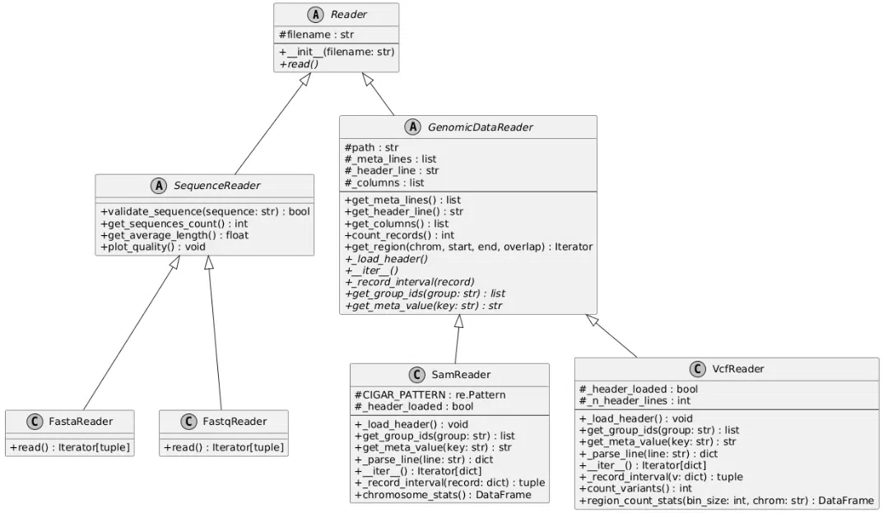

UML-диаграмма проекта
=======================
Диаграмма классов
-----------------
**UML**-диаграмма показывает структуру основных компонентов программы, их атрибуты, методы и связи между классами. Она помогает понять организацию проекта и взаимодействие его частей.

